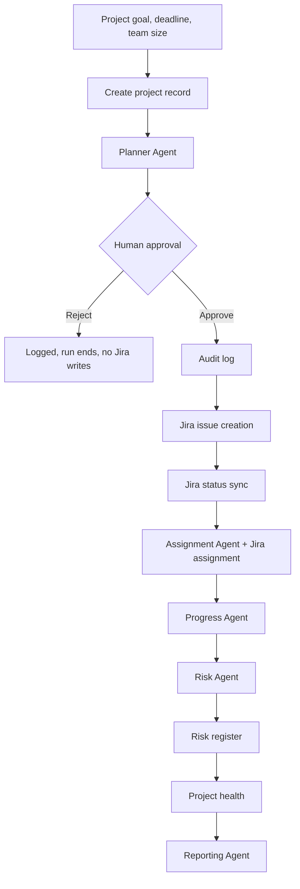

# ProjectPilot AI

A multi-agent AI assistant that turns a plain-English project goal into a reviewed plan, real Jira issues, assignments, risk analysis, a health status, and a status report. It runs on a local LLM (Ollama) and uses Jira Cloud as the system of record.

> **Status:** final-year B.E. project, working prototype. The sections *Currently Implemented* and *Planned Features* are kept strictly separate. Nothing in the planned section is claimed to exist.

---

## 1. Project Overview

Project managers spend a lot of time on repetitive work: breaking goals into tasks, assigning people, checking Jira for status, spotting risks, and writing reports. ProjectPilot AI automates that loop with five specialised agents orchestrated by LangGraph, and keeps a human in control of the one action that writes to Jira.

Design principles used throughout the codebase:

- **Agents decide, deterministic code acts.** The LLM never calls Jira directly. Jira writes happen in plain Python after validation.
- **Don't let the LLM own facts.** Progress numbers, risk selection, and health status are computed in code. The LLM only writes explanations.
- **Validate every LLM output.** Responses are schema-constrained, checked against real input (task titles, team names), and retried up to a fixed limit before failing loudly.
- **Human approval before side effects.** The generated plan is shown for approval before any Jira issue is created.

| Agent | Role | LLM involved? |
|---|---|---|
| Planner | Goal to epics and tasks (priority, estimate) | Yes |
| Assignment | Matches tasks to team members by skill | Yes |
| Progress | Counts and completion percentage | No (deterministic) |
| Risk | Selects at-risk tasks by rule, LLM explains severity and mitigation | Hybrid |
| Reporting | Narrative status report; numbers copied from Progress | Narrative only |

---

## 2. Technology Stack

| Area | Technology |
|---|---|
| Language | Python 3.13 (developed on 3.13.7) |
| Orchestration | LangGraph 1.2.11 (state graph, `interrupt()`, in-memory checkpointer) |
| LLM framework | LangChain; the `ollama` Python client is used directly for structured output |
| Local LLM | Ollama running `qwen3:4b` (reasoning mode disabled with `think=False`) |
| Validation | Pydantic |
| UI | Streamlit (single page) |
| Database | SQLite via SQLAlchemy 2.0 ORM |
| Migrations | Alembic |
| External system | Jira Cloud REST API v3 (via `httpx`) |
| Config | `python-dotenv` |
| Testing | pytest |

`requirements.txt` also lists `fastapi`, `uvicorn` and `chromadb`. **They are not used by the current implementation**; they are reserved for planned work (see section 8).

---

## 3. Currently Implemented Features

| Feature | What it does | Notes |
|---|---|---|
| Project run persistence | Every run creates a `projects` row (goal, deadline, team size, timestamp) linked to its task links and audit entries | No project-management UI |
| AI task generation | Planner Agent produces epics and tasks (title, description, priority, estimated days) | Schema-constrained output, max 3 retries |
| Human approval | The graph pauses after planning; the UI offers **Approve** or **Reject** | Reject stops the run before Jira is touched |
| Audit logging | Every approval decision is stored with the proposed plan and outcome | Stored in the `audit_log` table |
| Jira issue creation | Creates one Jira `Task` per planned task | Idempotent: a task title already linked in the project is reused, not duplicated |
| Task assignment | Assignment Agent picks a team member by skills; the issue is then assigned in Jira using the member's `jira_account_id` | Skills only; see limitations |
| Jira status sync | Reads live issue status from Jira and maps it to an internal status | Mapping table for the `AIPM` project; category fallback for others |
| Progress tracking | Completed, total, in-progress, todo counts and completion percentage | Deterministic |
| Risk identification | Rule-based selection (overdue/flagged, blocked, or high priority still `todo`); LLM adds severity, reason, recommendation | A healthy project returns zero risks with no LLM call |
| Risk scoring | Probability x impact score computed in code | Pure function, unit-tested |
| Risk register | Scored risks persisted to a `risk_register` table | Backend only; **not yet displayed in the UI** |
| Project health | Green / Yellow / Red computed from risks, overdue and blocked counts, with a rule-generated explanation | Deterministic, no LLM |
| Status report | Summary and recommendations from the Reporting Agent | Counts are copied from Progress, never generated by the LLM |
| Streamlit UI | Goal form, approval screen, Jira links, assignments, progress, health badge, risks, report | Single page |

---

## 4. System Workflow



Notes on the sequence:

- The audit log node runs for every decision, including rejections, and then a conditional edge either ends the run or continues to Jira.
- Status sync runs **before** assignment in the graph. Newly created issues all start in the same status, so this order does not change results.
- The graph is compiled with an in-memory checkpointer; a paused run lives only as long as the Streamlit process.

---

## 5. Project Setup and Execution

### Prerequisites

- Windows with PowerShell
- Python 3.13
- Git
- [Ollama](https://ollama.com) installed and running
- A Jira Cloud site with a project that has a **Task** issue type and the workflow statuses *Idea, To Do, In Progress, Testing, Done* (the status mapping is written for this workflow)

### Install

```powershell
git clone https://github.com/siddantmagar/ProjectPilot-Ai.git
cd ProjectPilot-Ai\ai-project-manager

python -m venv venv
.\venv\Scripts\Activate.ps1
# If activation is blocked: Set-ExecutionPolicy -Scope Process -ExecutionPolicy Bypass

python -m pip install --upgrade pip
pip install -r requirements.txt
```

### Configure the LLM

```powershell
ollama pull qwen3:4b
```

The model name is currently set in the agent code. The `LLM_PROVIDER` and `LLM_MODEL` entries in `.env.example` are not read yet.

### Configure Jira

```powershell
Copy-Item .env.example .env
```

Edit `.env` and fill in your own values:

```
JIRA_BASE_URL=https://<your-site>.atlassian.net
JIRA_EMAIL=<your Atlassian login email>
JIRA_API_TOKEN=<token from https://id.atlassian.com/manage-profile/security/api-tokens>
JIRA_PROJECT_KEY=<your project key>
```

`.env` is git-ignored. Never commit it or share the token.

### Create the database

The application does not create tables on its own:

```powershell
alembic upgrade head
```

### Add at least one team member

There is no team-management UI yet. Members are added through the repository. Resolve the Jira account ID from an email, then insert:

```powershell
python -c "from app.integrations.jira.client import get_account_id_by_email as g; u=g('member@example.com'); print(u.account_id, u.display_name)"

python -c "from app.database.connection import SessionLocal; from app.database.repositories import TeamRepository; s=SessionLocal(); TeamRepository(s).add(name='DISPLAY_NAME', jira_account_id='ACCOUNT_ID', weekly_capacity_hours=40, skills={'python':'high','react':'medium'}, email='member@example.com'); s.close()"
```

Skill levels must be exactly `low`, `medium` or `high`. The member must be assignable in the Jira project, otherwise assignment fails. Running the graph with no team members raises an error.

### Run

```powershell
streamlit run frontend/app.py
```

Open the URL Streamlit prints (default `http://localhost:8501`). A full run takes roughly a minute or two on CPU-only hardware (observed during development, not a benchmark). **Each approved run creates real issues in your Jira project.**

---

## 6. Project Structure

```
ai-project-manager/
├── app/
│   ├── agents/          planner, assignment, progress, risk, risk_score, health, reporting
│   ├── graph/           state.py, nodes.py, workflow.py (LangGraph definition)
│   ├── models/          Pydantic models (tasks, assignment, progress, risk, report, health, team)
│   ├── database/        connection.py, models.py (SQLAlchemy ORM), repositories.py
│   ├── integrations/
│   │   └── jira/        client.py (REST calls), schemas.py, status_map.py
│   ├── api/, tools/, llm/   scaffold folders, not used by the current implementation
├── alembic/             database migrations
├── alembic.ini
├── frontend/app.py      Streamlit application
├── scripts/             verify_*.py manual verification harnesses
├── tests/
│   ├── agents/  database/  graph/  integrations/
├── pyproject.toml       pytest configuration (registers the `integration` marker)
├── requirements.txt
└── .env.example
```

Database tables: `projects`, `team_members`, `task_jira_links`, `audit_log`, `risk_register`.

---

## 7. Testing

Framework: **pytest**. The `integration` marker flags tests that call the real local LLM.

```powershell
pytest tests/ -v                       # everything (slow: includes real LLM calls)
pytest tests/ -m "not integration"     # faster subset
python -m scripts.verify_status_sync   # example of a manual harness
```

**Last recorded full-suite run: 92 tests passed** (at milestone `v1.3-health-dashboard`). Breakdown from that run:

| Area | Tests |
|---|---|
| Agents (planner, assignment, progress, risk, reporting, health) | 33 |
| Database (team repository) | 5 |
| Graph (nodes, approval gate, project wiring, workflow) | 25 |
| Jira integration (client, users, search, assign, status map) | 29 |

Tests added after that run (risk scoring and the risk register) were passing individually when written. A fresh full-suite run is recommended after cloning.

Notes:

- The end-to-end workflow test uses real agents and **creates real Jira issues**.
- `scripts/verify_*.py` are manual harnesses. Those touching Jira (create, assign, status sync, interrupt, project wiring) also create real issues.
- LLM-backed tests can occasionally fail on model variance; see limitations.

---

## 8. Planned Features (Future Scope)

None of the following is implemented. These are directions under consideration.

| Area | Idea |
|---|---|
| Team management | UI to add, edit and import team members (including import from Jira project membership) |
| Workload-aware assignment | Use `weekly_capacity_hours` and real Jira effort data, so assignment weighs availability as well as skill |
| Advanced risk prediction | Trend-based or history-informed risk scoring |
| Dependencies and critical path | Task dependency modelling and critical-path analysis |
| Timeline views | Gantt chart and timeline visualisation |
| Natural-language queries | Ask questions about the project in plain English |
| Historical memory | Reuse past projects and analytics (ChromaDB is already listed as a dependency for this) |
| Notifications | Alerts and automated reminders for delays and blockers |
| Reporting | Weekly scheduled reports with PDF/DOCX export |
| Approval gate | "Modify" option in the UI (the graph node already supports an edited plan) and a second approval before assignment |
| API layer | FastAPI backend for multi-user or external clients |
| Risk register UI | Display the stored register in the dashboard |

---

## 9. Known Limitations

Stated plainly so reviewers know what to expect:

- **Small local model.** `qwen3:4b` is occasionally inconsistent. The most common case is a corrupted assignee name when only one team member exists; validation rejects it and retries (up to 5 attempts), and can still fail a run. Stored-name checks guarantee a corrupted value never reaches Jira.
- **Assignment uses skills only.** `weekly_capacity_hours` is stored but not used. `workload_percent` is a legacy field that defaults to 0.
- **"Overdue" is the Jira flag.** No due dates are set on created issues, so `is_overdue` comes from Jira's flagged field.
- **"Blocked" is not populated from Jira.** The internal status exists, but the current Jira status mapping never produces it.
- **Planner priority is internal.** It is not synchronised with Jira's own priority field.
- **Status mapping is tied to one workflow.** The explicit map covers project key `AIPM`; other projects fall back to Jira's status category.
- **Jira search is not paginated** (first 100 issues) and relies on Jira's search-and-reconcile parameter because newly created issues are not instantly searchable.
- **Checkpoints are in memory.** A paused approval is lost if Streamlit restarts.
- **Task idempotency is by title** within a project key; renaming a task creates a new issue.

---

## 10. Security

Credentials live only in `.env`, which is excluded by `.gitignore`. The application authenticates to Jira with a single application API token and never asks team members for their own passwords or tokens.
